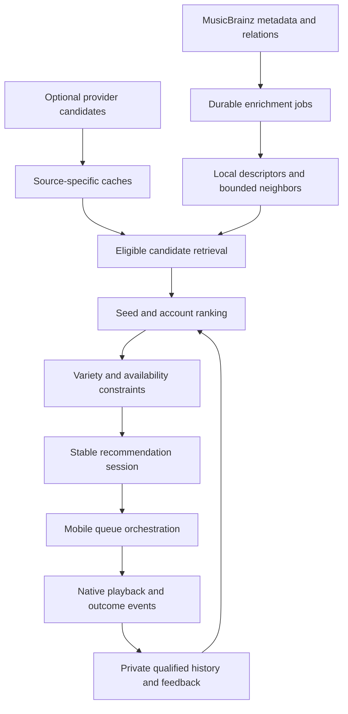

# Music linking, track radio and personalized mixes

Research and source review: 2026-11-03.

## 1. Recommendation

Build a recommendation service around MusicBrainz identities and musical relationships,
qualified local listening history, and playable local recordings. Add genres and styles
as weighted descriptors. Use optional ListenBrainz similarity for broader candidates.
Add local audio analysis after measuring the metadata baseline. Keep Last.fm and
Discogs replaceable enrichments, rather than prerequisites for playback.

This is a design proposal, not an implementation or a measured recommendation-quality
result. Two agents contributed: one researched official metadata/provider documentation;
one audited the repositories. The parent checked key findings and designed the flows.
No private database, account history or music files were inspected. No provider catalog
queries, app/device playback, tests, migrations or deployment were performed for this analysis.
Actual library size, metadata coverage and expected quality remain unmeasured.

There are three distinct decisions:

| Decision | Example question | Required evidence |
| --- | --- | --- |
| Identity | Is this local recording the same recording as a Spotify result? | Recording identifiers, actual import evidence, artist/title/version safeguards |
| Musical relationship | Which recordings share a style, performer, producer, composition or sound? | Source-qualified metadata, explicit graph relationships and optional audio features |
| Personal recommendation | Which related track should this account hear next? | Musical relationship plus preference, context, availability, novelty and variety |

Do not let genre similarity or an embedding confirm a Spotify recording association.
A cover, remix or similar-sounding song may be a good recommendation and still be the
wrong recording for Jam. Recommendation uncertainty must not weaken identity matching.

The recommended first deliverable is a useful Track Radio over the existing playable
catalog, with reasons and variety controls. It should work without Spotify or Last.fm
login, a ListenBrainz account, a GPU, or a large population of local users.

## 2. What the application already has

### Useful data already present

- Recording identifiers, titles, lengths and individual recording artist credits.
- Canonical artists, aliases and some artist tags.
- Releases and their recordings, although the membership model is incomplete.
- Per-account listens with validated played seconds, duration, timestamps, pause/seek
  events, anomaly fields, and explicit source album or playlist.
- Saved albums and likes through membership of the selected Liked Songs playlist.
- Account-aware Home queries and native queue lifecycle fences.

A new recommender should reuse these. A second likes store or replacement player is
unnecessary. Local history does not require Last.fm to be connected.

### Concrete gaps found in source

| Finding | Consequence | Source |
| --- | --- | --- |
| Home returns recent collections, saved albums, more from the same artists, and recently imported albums | These sections are useful navigation, but are not a track similarity or discovery system | [RecommendationService](StreamingServiceServer.Business/Services/Recommendation/RecommendationService.cs) |
| Artist suggestions use any listen and the release artist, ordered by DateAdded | A short failed attempt counts as interest; featured performers are missed; import date is not personal relevance or original release date | [ArtistAlbums](StreamingServiceServer.Business/Services/Recommendation/RecommendationService.cs#L126) |
| Queue suggestions use OrderBy(Guid.NewGuid()) | Queue continuation has no seed, preference, exclusions or musical connection | [GetSuggestedRecordings](StreamingServiceServer.Business/Services/Metadata/MetadataService.cs#L47) |
| ArtistTag stores a name, while TagDto has a count that the mapper discards | Votes cannot be weighted, audited or refreshed properly | [ArtistTag](StreamingServiceServer.Data/Models/ArtistTag.cs), [mapper](StreamingServiceServer.Business/Models/MusicSearch/MusicSearchExtensions.cs#L40) |
| Artist import reuses existing artists without a dedicated enrichment refresh | Existing tags cannot be assumed complete or current | [MetadataService](StreamingServiceServer.Business/Services/Metadata/MetadataService.cs#L304) |
| Release DTO fields such as release group/date/country are discarded on persistence | Useful album identity and era information is lost despite already being returned | [Release mapper](StreamingServiceServer.Business/Models/MusicSearch/MusicSearchExtensions.cs#L95) |
| A recording has one Release; importing an existing recording assigns it to the new release | Edition and compilation membership can overwrite the previous album association | [UpsertRecordings](StreamingServiceServer.Business/Services/Metadata/MetadataService.cs#L374) |
| No persisted recording genres, release groups, works, recording relations, ISRCs, acoustic vectors or recommendation exposures | A genre-based radio or learning system has no durable feature layer yet | [models](StreamingServiceServer.Data/Models), [context](StreamingServiceServer.Data/StreamingDbContext.cs) |
| Native reporting drops EntryChanged.reason | Natural completion, manual next and selection cannot be distinguished in saved history | [NativePlaybackReporting](../StreamingServiceMobile/src/services/player/NativePlaybackReporting.ts#L49) |
| PlaybackTracker counts nonpaused elapsed time | Validated totals are not proof that audio progressed; a stuck output can inflate apparent engagement | [PlaybackTracker](../StreamingServiceMobile/src/services/PlaybackTracker.ts) |

The existing Listens table is more useful than a raw play count. However, its
ProgressCheckpoints property is not mapped and returns an empty list. Do not treat
that property as persisted progress evidence or infer historical skips from it.

### Data integrity prerequisite

The progress/stop actions in LastFmController do not visibly require an authenticated
account or check ownership of the session being mutated. Service lookups use SessionId
without UserId. This is a source finding, not a runtime exploit test. Before trusting
richer feedback, require authentication and bind every progress, stop and event write
to both account and session. Add foreign-account and anonymous regression tests.

See [controller](StreamingServiceServer.API/Controllers/LastFmController.cs#L186) and
[session queries](StreamingServiceServer.Business/Services/LastFm/LastFmService.cs#L402).
A difficult-to-guess session identifier is not an authorization rule.

## 3. What MusicBrainz metadata can and cannot tell us

### Genres and styles

MusicBrainz genres are recognized terms within its folksonomy tag system. Associations
are voted by editors. Free-form tags can also describe nationality, professions,
maintenance requests or opinions. Therefore, import approved musical descriptors,
not every tag as a genre. A vote count is evidence of community agreement, not a
probability that a genre is correct. Missing tags mean unknown, not that a track
has no genre. [MusicBrainz Genre](https://musicbrainz.org/doc/Genre),
[Folksonomy Tagging](https://musicbrainz.org/doc/Folksonomy_Tagging).

Discogs explicitly distinguishes broad genres and finer styles/subgenres. That may
be the structure meant by styles. MusicBrainz does not provide the same complete,
ordered taxonomy by default. Preserve provider vocabularies and maintain reviewed
cross-provider mappings rather than merging all equal text automatically.
[Discogs guidelines](https://support.discogs.com/hc/en-us/articles/360005055213-Database-Guidelines-9-Genres-Styles).

For this app, genres/styles help with genre radio, focused mixes, browsing, discovery
near liked tracks, and understandable reasons. They do not reliably supply mood,
energy, tempo, instrumentation, or the actual sound of every track by an artist.
A broad shared genre alone is a weak link.

### Use the right entity

| Entity or relation | Useful application | Mistake to avoid |
| --- | --- | --- |
| Recording | Direct track descriptors, performer credits, identity | Treating every release track as a new recording |
| Release | Edition, country, track/disc order, available file association | Calling the newest imported edition the original album |
| Release group | Album-level identity, original era, edition deduplication | Queueing all editions of the same album as discoveries |
| Work | Covers, compositions, songwriter/composer browsing | Assuming all performances of a work sound similar |
| Artist credits | Performer affinity and collaborations | Using only the album artist or merging aliases into one unrelated artist |
| Production/performance relationships | Producer, remixer, group member and instrument exploration | Giving every collaborator equal similarity weight |
| Recording relationships | Versions, remixes, live/original connections | Treating related recordings as interchangeable audio |
| External identifiers and links | Join metadata across providers | Treating ISRC or name text as an infallible unique key |

A MusicBrainz recording can occur on many releases; a release group groups editions
of an album. A work can have several recordings. These distinctions support both
better discovery and fewer duplicate recommendations. Mastering differences do not
necessarily create another MusicBrainz recording, so file-specific sound descriptors
must remain attached to an audio asset. [Recording](https://musicbrainz.org/doc/Recording),
[Release group](https://musicbrainz.org/doc/Release_Group),
[Work](https://musicbrainz.readthedocs.io/en/latest/terminology/entities/work.html).

MusicBrainz ISRC lookup can return multiple recordings. Store external identifiers
as potentially ambiguous associations, and retain conflicting evidence for review.
Dates also need precision: a known year is not a known January 1 date.
[MusicBrainz API](https://musicbrainz.org/doc/MusicBrainz_API).

Do not use artist gender, nationality or user demographics as a substitute for sound.
Language can be an optional explicit user filter where evidence exists; artist country
does not establish lyric language. Missing explicit-content evidence does not mean clean.

## 4. Source strategy

| Source | Role | Priority and boundary |
| --- | --- | --- |
| Existing catalog and local preferences | Immediately available candidate pool and account affinity | Required; establish eligibility and data integrity first |
| MusicBrainz core | Identity, credits, release groups, works and explicit relations | Primary enrichment source |
| MusicBrainz genres/tags | Musical descriptors with votes and provenance | Primary descriptive layer, with licensing and coverage limits |
| ListenBrainz | Similar artists/recordings and optional listening-derived candidates | Optional expansion; cache and tolerate absent results |
| Discogs | Finer release/master styles | Later adapter if the actual library needs it and current API access/terms are validated |
| Last.fm | Similar artists/tracks and top tags | Optional bounded fallback, not an unrestricted metadata mirror |
| Local audio analysis | Similar sound, tempo/loudness and predicted descriptors | Later isolated worker, after quality/cost/license evaluation |
| AcoustID/Chromaprint | Identify uncertain files | Identity tool, not musical similarity |
| AcousticBrainz | Historical acoustic features | Opportunistic only; not the ongoing feature pipeline |
| Spotify recommendation/audio APIs | Potential account-specific external functionality | Do not require access that this app has not verified |

### ListenBrainz

Production docs describe artist radio returning recording MBIDs. Personalized
collaborative recommendations are a different flow; the documented endpoint is
experimental and may return 204 when results have not been generated. Similar
recordings/artists also exist through a separate dataset hoster. Treat each as a
versioned provider, not one guaranteed production endpoint.
[Core API](https://listenbrainz.readthedocs.io/en/latest/users/api/core.html),
[recommendation API](https://listenbrainz.readthedocs.io/en/latest/users/api/recommendation.html),
[dataset hoster](https://labs.api.listenbrainz.org/).

A local radio can use public similarity without exporting this account's history.
Personalized ListenBrainz integration requires an explicit choice: submitted listens
are public data under its terms. Never silently enable history upload because the
user opened radio. Empty, stale, unmapped or unavailable suggestions fall back locally.
[ListenBrainz terms](https://listenbrainz.org/terms-of-service/).

### Last.fm and Discogs

Last.fm exposes track/artist similarity and tags; an API key is needed, while these
read methods do not require a user's session. Some returned MBIDs may be absent.
Resolve identity separately and keep each provider's score scale separate.
[Track similarity](https://www.last.fm/api/show/track.getSimilar),
[artist similarity](https://www.last.fm/api/show/artist.getSimilar),
[track tags](https://www.last.fm/api/show/track.getTopTags).

The current Last.fm terms require attribution, header-aware caching and a total
reasonable usage cap of 100 MB unless permission is granted. Commercial use requires
separate agreement. Keep its assertions/cache removable and source-labelled.
[Last.fm terms](https://www.last.fm/api/tos).

For Discogs, prefer actual linked release/master identifiers. Release-level style
is not direct evidence for every track on a mixed compilation. The official API
documentation returned 403 during research; exact current quotas, search authentication
and caching/storage terms remain unverified. Do not implement guessed limits from
unofficial examples. [Official API docs](https://www.discogs.com/developers).

### Audio and Spotify

AcoustID finds near-identical audio candidates, not similar taste or mood. AcousticBrainz
stopped collecting new data in 2022, although its current site says historical access
remains available for now. These are different tools.
[AcoustID](https://acoustid.org/), [AcousticBrainz](https://acousticbrainz.org/).

Essentia offers local analysis, embeddings and classifiers. Its library and pretrained
models have separate licensing; the documented AGPL/commercial library options and
noncommercial/share-alike model terms need review for the selected deployment/model.
An isolated worker alone does not resolve those obligations.
[Essentia models](https://essentia.upf.edu/models.html),
[licensing](https://essentia.upf.edu/licensing_information.html).

Spotify's published Web API changes restricted access to recommendation, audio and
related-artist capabilities for affected/new use cases. Pairing a native client does
not establish Web API entitlement. The proposed radio remains independent of this.
[Spotify announcement](https://developer.spotify.com/blog/2024-11-27-changes-to-the-web-api).

### Licensing affects architecture

MusicBrainz core identity and relationships are CC0, while supplementary data including
tags/genre associations has different, noncommercial/share-alike terms. Keep source
and license attribution on assertions and derived datasets, with a provider disable
and purge/rebuild path. Do not assume that a genre vocabulary makes every assignment
CC0, or that future commercial deployment has identical permissions.
[Data license](https://musicbrainz.org/doc/About/Data_License),
[database contents](https://musicbrainz.org/doc/MusicBrainz_Database).

## 5. Database design

Use additive migrations. Preserve existing recording IDs, playlist membership,
likes, listens, streaming URLs and Spotify associations. Do not replace the catalog
with a new universal graph before a useful radio exists.

The following are logical records. Physical association tables should have real
foreign keys, typed external entity kinds and uniqueness constraints. Avoid a generic
unconstrained subject-ID column pointing at unrelated tables.

### Catalog and evidence

| Record | Essential fields and constraints |
| --- | --- |
| ExternalEntity | Provider, entity type, external ID; unique tuple; redirect/merged/deleted status |
| RecordingExternalLink / ArtistExternalLink / ReleaseExternalLink | Local FK, ExternalEntity FK, evidence source, resolution state; ambiguous links do not become identity |
| ReleaseGroup | Internal ID, external identity, title, primary/secondary type, first release date plus precision |
| Release enrichment | ReleaseGroup FK, release date/precision, country, status; keep DateAdded separate |
| RecordingRelease | Recording FK, release FK, release-track external ID when known, disc/track position, credited spelling; unique occurrence within release |
| Work and RecordingWork | Typed work identity and relationship attributes, not a one-to-one SongId |
| MusicRelationship | Typed source/target entity FKs, relation type, role, direction, dates/attributes, provenance |
| DescriptorTerm | Provider vocabulary, original/normalized name, category such as genre/style/mood, optional external genre ID |
| DescriptorMapping | Reviewed alias/parent mappings, relation type, version and source; not automatic substring merging |
| RecordingDescriptor / ArtistDescriptor / ReleaseGroupDescriptor | Entity FK, term FK, source, votes, fetched time, provider generation time where supplied, direct/inherited/model origin |
| AudioAsset | Recording link, content hash, variant, readiness/failure, duration, format and permissions/storage reference |
| AudioFeature | Asset FK, model/checksum/version, preprocessing, segment or pooled vector, extraction state, quality and timing |
| RecordingNeighbor | Seed/candidate recording, algorithm version, source evidence, score, generation time; bounded top neighbors |

If assertions must cover external discoveries not yet imported, attach descriptors to
ExternalEntity and join through validated local links. Keep local correction tables
separate. This permits foreign keys without requiring every discovered track to be
inserted into the playable catalog. In v1, only implement the entity types actually
used by enabled candidate providers; Work and richer roles can follow later.

The current single Recording.Release relationship needs careful migration. Add
RecordingRelease first and backfill only the association known today. Keep a
compatibility primary-release view for existing screens. Lost historical membership
cannot be reconstructed from that one FK without further metadata. Do not label the
current release as original during backfill. Track position belongs to a release
occurrence, not globally to a recording. Repeated recordings on one release must remain
representable; RecordingId plus ReleaseId alone is not a sufficient occurrence key.

### User and recommendation state

| Record | Essential fields |
| --- | --- |
| Playback outcome extension | Account/session/queue occurrence, actual progressing playback, reason, initiator, context kind, radio/session item, anomaly/error/buffer markers |
| RecommendationSession | Account, seed kind/ID, mode, constraints, ranking version, profile/catalog versions, availability scope, deterministic random seed, cursor and expiry |
| RecommendationItem | Session, stable item/occurrence ID, recording, position, reason codes, scoring version, selected/consumed state |
| RecommendationExposure | Account/session/item, surface, visible/queued/started event type, timestamp, idempotency key |
| RecommendationFeedback | Account, target item/recording/artist, action such as less-like-this/block/undo, timestamp and origin |
| UserAffinity | Account, entity/descriptor, long-term or recent interest, positive/negative confidence, decay/update versions |
| EnrichmentJob | Provider/entity/version dedup key, priority, lease, attempts, not-before, last success/failure class and cancellation state |

Keep supplied native enum values and new protocol meanings named/versioned. A radio
session is not a user playlist. Save as playlist creates a snapshot; it must not
silently change tomorrow or modify the selected Liked Songs playlist. Generated
mix snapshots can rotate on an explicit schedule without overwriting user edits.

### Indexes and storage

Start in PostgreSQL with normalized descriptor joins and bounded neighbor tables.
Index descriptor-to-recording lookup, canonical credit artist-to-recording lookup,
release-group membership, account/time listens, session cursor, feedback target,
ready assets, and unique provider/entity/job keys. Use transactional outbox rows,
leases and bounded batches before adding a separate queue service.

Keep global musical features separate from private account affinities and per-device
download manifests. Add a vector extension/index only after exact or precomputed
neighbor search becomes a measured bottleneck. Do not build an all-pairs similarity
matrix: compare bounded candidate pools and retain only useful neighbors.

Planning calculation, not a benchmark: a 512-element float32 vector is 2,048 bytes.
At 100,000 assets that is 204.8 MB of raw vectors, before rows/indexes/model storage.
Ten vectors per asset make that 2.048 GB. Fifty neighbor edges per recording make
five million rows at that catalog size. Start with pooled vectors if and when audio
analysis justifies the cost; retain a path to segment summaries for long tracks.

## 6. How the database gets populated

### New import

1. Commit the playable catalog import and known external identities.
2. In the same transaction, write outbox jobs for missing artist/release-group/recording
   enrichment. Playback becomes available independently of these jobs.
3. Deduplicate by provider, typed entity and requested schema/version. The same artist
   on several albums creates one pending fetch, not one per song.
4. Fetch source metadata through one provider scheduler. Validate IDs, entity kind,
   shape, response bounds and relation types before storing source assertions.
5. Normalize approved musical terms, retain votes and provenance, and mark inherited
   descriptors explicitly. Do not manufacture moods from genre names.
6. Recompute affected local features and bounded neighbor sets. Increment feature
   versions and invalidate affected caches, not every account's entire library.
7. Publish aggregate coverage/progress. Failed enrichment never rolls back the audio
   import or removes last successful metadata.

### Existing library backfill

First produce aggregate counts: known external identity, directly tagged recordings,
release-group/artist fallback, ready audio, ambiguous matches, qualified history,
abandoned sessions and enrichment age. These are unknown for the actual database today.

Prioritize ready recordings that are liked/listened to or selected as seeds, and their
distinct artists/release groups. Then process the rest of the local catalog in
resumable keyset batches. Avoid recursively crawling the global collaborator graph.
A manual correction remains an override and survives every provider refresh.

Store successful empty metadata separately from a temporary failure. A timeout is not
an empty tag set. Retries cannot repeatedly erase good assertions or overwrite a newer
normalization/model generation. Leases must survive worker crashes and expire safely.
New imports, explicit requests and meaningful source/version changes trigger refresh.
Do not repeatedly poll every MusicBrainz entity just to discover whether it changed.

### Provider traffic and reliability

MusicBrainz documents a public-IP budget of about one request per second unless
otherwise agreed, and requires an identified User-Agent. Imports, enrichment workers
and retries need a shared budget. The current initial-request semaphore is process-local,
and retries are outside that gate. It should be replaced or composed with a shared
scheduler before bulk enrichment. More workers or more tokens are not a quota solution.
[MusicBrainz rate limiting](https://musicbrainz.org/doc/MusicBrainz_API/Rate_Limiting).

Each actual send, including retries, observes the gate. Honor Retry-After/reset headers
when provided; handle MusicBrainz 503 as well as 429; use backoff, jitter and bounded
retry budgets. Separate foreground import priority from bulk work without starving
backfill. Persist cooldown/not-before so a restart does not cause a burst.

ListenBrainz also documents a conservative one-call-per-second usage rule and dynamic
rate-limit response headers. AcoustID documents three per second for its public service.
Other providers need independently validated budgets.
[ListenBrainz API](https://listenbrainz.readthedocs.io/en/latest/users/api/index.html),
[AcoustID web service](https://acoustid.org/webservice).

A theoretical 10,000 uncached calls at one per second take at least 2h46m40s, before
retries and shared traffic. This is why deduplication, shared entity caching and
background backfill matter. It is not a predicted completion time for this library.

Use dumps only if targeted enrichment no longer fits the catalog/operational budget.
MetaBrainz offers PostgreSQL and JSONL dumps; live replication is a separate mirror
workflow with its own access and license terms. It is not an event feed directly
updating this application's tables. [Dumps](https://metabrainz.org/datasets/postgres-dumps),
[Live Data Feed](https://musicbrainz.org/doc/Live_Data_Feed).

## 7. Recommendation engine

Use separate candidate retrieval, scoring and constrained sequencing. This is a
standard architecture; the specific sources, filters and policies below are proposed
for this app, not a claim to reproduce Spotify's internal algorithm.
[Google recommendation architecture](https://developers.google.com/machine-learning/recommendation/overview/types).

### Ownership and data flow

Metadata jobs and preference updates run outside playback control calls. Player does
not need a recommendation provider to play an already accepted queue entry.

### Eligibility comes first

A normal radio candidate must have a known local recording identity, allowed content
under the current authorization policy, a ready usable asset, and no user exclusion.
The current catalog is shared across authenticated users; do not invent recording
ownership where none exists. Private playlists/listens/preferences remain account-bound.

Separate four modes:

- Server-library radio: playable recordings in the authorized server catalog.
- Your-library radio: additionally restricted to the account's saved/liked selections.
- Downloads-only radio: additionally restricted to a current account/server/device
  download manifest and file checks; server presence alone cannot promise offline audio.
- External discovery: metadata results outside available audio, shown as discovery items.

Do not put an unavailable discovery into a playing queue and silently trigger a
preview/download. Acquiring it is a separate user action and worker flow. Availability
is checked at retrieval, after cache reuse, and again at playback; a removed asset
must fail safely without corrupting the recommendation session.

### Candidate generators

Retrieve bounded pools from several independent routes:

1. Direct recording or release-group descriptors, with inverse prevalence for generic terms.
2. Canonical recording artists, plus properly weighted performer/producer/remixer relations.
3. Similar artists and recording IDs from cached ListenBrainz/optional providers,
   resolved back to actual eligible local recordings.
4. The account's liked/saved/qualified-listened neighborhoods, matched to the current taste area.
5. Controlled exploration from eligible, less-exposed local recordings.
6. Later, audio-vector neighbors for assets with validated model coverage.

Track each pool's provenance and size. The same tag copied through two providers is
not two independent votes. High-degree producers and broad genres must not dominate
because they connect to many recordings. An artist's whole discography is not one sound.

### Descriptive similarity and inheritance

Use multi-label descriptors, not one Genre column. Start with weighted sparse vectors
and a transparent overlap/cosine measure. Specific shared terms usually discriminate
better than a term applied to most of the catalog. Learn or cap rarity weights so a
one-off erroneous tag cannot dominate.

Direct recording evidence generally deserves more weight than relevant release-group
inference, which generally deserves more than artist fallback. This is a starting
hypothesis to validate, not a fixed universal ratio. Mixed compilations and artists
with broad catalogs need special caps. Retain conflicting descriptors rather than
pretending one provider is always correct.

Do not infer a taxonomy through string matching: similarly written style names can
mean different things. Keep reviewed synonyms and parent relations with versions.
Audio-predicted genres remain a separate probability-bearing source, not editorial fact.

### What audio analysis would add

Genre describes a category, while an audio embedding can retrieve recordings with
similar timbre, rhythm or production even when metadata is sparse. Tempo, loudness,
speech/instrumental estimates and model-predicted mood can help focused playlists,
but these features need different interpretations. Loudness is not identical to
perceived energy. Tempo can have half-time/double-time ambiguity. Key compatibility
can matter for a DJ-style sequence without being a general measure of taste.

Use one chosen model/preprocessing version for comparable vectors. A model upgrade
requires a separate feature generation and measured neighbor rebuild, not mixing
incompatible vectors in the same index. Analyze ready local assets once per content
hash. Preserve failed/partial extraction and unknown duration instead of generating
zero-valued pretend features. Long tracks may need segment summaries; an intro-only
analysis can misrepresent the rest of the recording. Predicted moods and instruments
must be labelled predictions and evaluated against the genres actually in this library.

Spoken interludes, skits, ambient pieces and long classical movements need explicit
policy rather than blanket short/long-track exclusion. A skit can be correct within
album playback and unwanted in a continuous music radio. Preserve album order and
separate radio constraints. Work/movement metadata can improve sequencing when it
exists; missing classification must not silently discard unconventional recordings.

### Personal scoring

Candidate score should combine seed similarity, account affinity, recent session
interest, freshness to this user and a bounded exploration term, with penalties for
repeats, explicit exclusions and weak evidence. Normalize/calibrate each provider's
score against its own distribution; scores from different APIs are not comparable.

Keep missingness and confidence explicit. Missing audio features must not mean low
energy, and missing genres must not mean the user dislikes the track. Use a route with
sufficient evidence and shrink sparse estimates toward a baseline. Keep a confidence
floor for claims such as similar sound; otherwise explain the actual weaker relation.
Do not hardcode final percentage weights before evaluating the real library.

Profile building should:

- Use explicit likes and saves as strong positive choices, while retaining their source.
- Use engaged, progressing listens as weaker evidence, with duration-aware qualification.
- Cap repeated plays per session/day so loops do not take over the profile.
- Separate short-term interests from long-term taste and retain multiple taste clusters.
- Avoid averaging unrelated musical interests into a single vague preference vector.
- Downweight automatic exposure relative to an explicit selection, without treating
  autoplay as worthless evidence.
- Treat removal of a like as removal of a positive, not an explicit dislike.
- Keep account-level learning local unless the user opts into an external history service.

### Weighted randomness and sequencing

Sample from relevant ranked candidates with a persisted random seed, rather than
sorting all recordings by a random GUID. A small exploration share can widen the
selection, but it cannot bypass eligibility or strong user exclusions.

Then sequence for variety: avoid repeated recordings across editions, adjacent same
artists, repeated release groups, near-identical versions and already manually queued
entries. Do not count every featured artist as a hard collision or collaboration-heavy
music will be unfairly excluded. Keep seed relevance across continuation so repeated
nearest-neighbor hops do not drift into a different radio.

When constraints conflict, relax variety in a documented order or return a shorter
queue. Never relax access restrictions, confirmed identity, asset readiness or an
explicit block. A tiny library cannot produce endless genuinely novel music; say so.
Record why a constraint was relaxed so the UI can explain limited coverage.

## 8. Product flows

### Track Radio

1. The song menu offers Start track radio. The seed is a real recording ID, not a title string.
2. The app sends seed, familiar/balanced/discovery mode and availability/filter scope.
3. The server creates an account-bound recommendation session and returns a bounded
   first page with IDs, stable item IDs, reasons, availability and continuation cursor.
4. After explicit user action, Mobile installs the radio through the existing queue
   lifecycle. The first item may be the chosen seed or its first neighbor according
   to a documented, consistent product rule; do not accidentally play the seed twice.
5. Near a low-water mark, request the next page before the queue runs out. Current
   playback controls never await ranking or metadata network requests.
6. Recheck account, radio session and native queue/control revisions before appending.
   A late result after selecting an album is discarded; retrying a cursor cannot duplicate items.
7. Keep the original seed anchor. Explicitly selecting another seed starts a new session.
8. If providers fail, use cached/local candidates. If exhausted, stop cleanly or ask
   to broaden the mode; do not switch silently to global randomness.

Radio has its own listening SourceKind and RecommendationSessionId. Playing a radio
started from an album must not mark that album listened solely because it supplied
the seed. Album/playlist history retains the existing explicit queue-origin semantics.
A saved radio playlist later played as a playlist is attributed to that playlist.

### Personalized mixes

Provide distinct products with different objectives:

| Product | Selection and presentation |
| --- | --- |
| Familiar favorites | Strong positive history, controlled repeats, several artists |
| More like this track | Fixed seed, musical connection, modest account personalization |
| Explore near your taste | Related but less-heard recordings, broader artist variety |
| Genre/style mix | Explicit descriptor scope, actual supporting metadata, optional era filter |
| Rediscover | Previously engaged recordings not heard recently, still available |
| Daily taste mixes | Separate coherent taste clusters, stable rotation window |
| New to your server | Recently imported and eligible; do not label as newly released |
| New releases near your artists | Actual release-date evidence; separate from import date |

Keep recent collections/saved albums as navigation sections rather than disguising
them as discoveries. Choose Home sections based on sufficient data and avoid several
cards that lead to substantially the same recordings. Deduplicate across Home sections
while allowing familiar content in its deliberately labelled section.

Show reasons that are true and brief: shared style, related performer, from your
saved artists, or exploration. A confidence number is not useful product copy.
Offer save, more/less familiar, less like this, block artist and undo. Do not expose
another user's private history as an explanation.

### Artist, album and playlist radio

Artist radio samples across relevant works/eras before expanding to similar artists.
Album radio uses release-group descriptors and the album's track distribution rather
than copying one track's characteristics to all neighbors. Playlist radio uses multiple
representative seeds/taste clusters; one atypical track must not determine the entire mix.
User edits and intent matter more than assumed metadata purity.

### Jam integration

Recommendation logic belongs to Server, orchestration to Mobile, playback truth to
Player, and Spotify queue mapping to the existing Jam component. These boundaries stay
in place. A radio does not import app-specific recommendation code into the Jam package.

Only the current playback authority appends automatic radio pages. A remote participant
adding a track must not create a second radio producer or silently replace the seed.
Keep manual participant additions and current playback intact when refilling. In local
hosting mode, admitted local queue changes can flow through the existing controllable
queue mapping. While following Spotify, starting local radio requires the existing
explicit authority transition; a background radio response cannot overwrite the host.

## 9. Better listening signals

The current scrobble threshold is a reporting rule, not a universal positive-preference
label. Radio needs a separate, conservative engagement policy, using existing duration
and actual progress evidence where available.

Persist end reason and initiator: natural end, manual next/previous, selected another
track, queue replacement, remote participant action, removal, error, interruption,
app/session retirement and unknown. A native Next reason alone may not identify who
initiated it; carry caller-origin context where available and otherwise keep unknown.

A short listen is not automatically dislike. It can result from buffering, the current
emulator audio failure, checking the queue, an external participant, or a short track.
Seeks do not add listened seconds. Buffering and pauses are excluded. Stuck playback
whose position does not advance must not become a qualified listen merely because
intent says Play. Repeated audible sections and long tracks require explicit policies.

Use idempotent event IDs, session/occurrence identity, sequence/epoch fences and bounded
offline uploads. Late events belong to the captured account/track, not whichever user
is logged in when upload completes. An abandoned session is unknown completion, not
a guaranteed skip. Enrichment and preference aggregation stay out of audio control calls.

Distinguish generated, shown, queued and played. Generating 100 candidates is not 100
impressions. Log actual visible Home cards and accepted queued recommendations separately;
recording a start is still separate from qualified engagement. This allows learning
without pretending unseen suggestions were rejected. Exploration mode should retain
its selection probabilities if later evaluation uses them for exposure correction.

## 10. API and component outline

Names below are proposed contracts, not existing routes.

| Operation | Suggested responsibility |
| --- | --- |
| POST Recommendation/radio | Create an authorized seeded session with bounded constraints |
| GET Recommendation/radio/{session}/items?cursor=... | Return stable, idempotent continuation pages for the same account |
| POST Recommendation/feedback | Record explicit action/undo using server-bound account identity |
| GET Recommendation/mixes | Return versioned coherent mix summaries, with truthful reasons |
| GET Recommendation/coverage | Administrator aggregate enrichment readiness and job status |

Responses should include session/item IDs, recording IDs, cursor, reason codes,
ranking generation/version and availability mode, but not internal private evidence.
The client cannot choose a different UserId in the payload. Expired sessions have an
explicit restart flow, not an unrelated result set under the same cursor.

Useful injected server interfaces are MetadataProvider, EnrichmentScheduler,
PlayableCatalog, CandidateGenerator, RecommendationRanker, RecommendationSequencer,
PreferenceStore and RecommendationSessionStore. Keep protocol codecs, licensing-aware
provider caches and ranking separate. Start with one service deployment and PostgreSQL;
a Python/audio worker is optional and separate from interactive request handling.

Cache global features/neighbors by catalog and feature versions. Cache personalized
results by account/profile revision, seed/session, filters, mode, availability revision
and ranking version. Never share a personalized response just because its seed matches.
Explicit blocks revoke cached candidates promptly. Avoid a single global revision
that invalidates every cache on every small unrelated tag update.

## 11. Validation and observability

### What to measure before choosing weights

- Direct recording genre coverage versus inherited release-group/artist coverage.
- Correct identity, alias/redirect ambiguity and duplicate-edition rates.
- Ready full audio versus preview-only/missing assets, and offline device coverage.
- Counts of meaningful qualified listens, explicit positives, unknown outcomes and errors.
- Distinct consenting users if collaborative learning is considered.
- Optional provider recommendations that actually map into eligible local recordings.
- CPU, memory, analysis time and quality for a representative audio-model sample.

No actual percentages or throughput have been measured in this analysis.

### Offline evaluation

Compare current uniform randomness, same-artist retrieval, tags-only retrieval and the
combined system. Use chronological holdouts and user/session grouping. Do not randomly
split repeated listens from the same session or leak another edition of the same
recording into both sides and call it discovery. Separately test new artists and sparse
metadata. Preserve generation dates for external similarity so future data is not
silently used to evaluate a past recommendation.

Measure relevance against later genuine choices alongside artist diversity, catalog
coverage, repeated-version rate, novelty, empty/short results and unavailable starts.
A popularity-heavy system can score well on recall while recommending little that is
new. Treat the test as evidence for a small rollout, not proof that users prefer it.

Use explicit feedback and successful progressing listens in a small opt-in trial.
Report uncertainty when interactions are sparse. Do not optimize only for total time
played or assume every manual next is rejection.

### Dedicated regression suites

| Area | Required tests |
| --- | --- |
| Metadata | Votes/provenance, sparse tags, unknown terms, partial dates, merged IDs, aliases, multiple editions, repeat recordings on a release, compilation inheritance |
| Jobs | Outbox atomicity, dedup/leases, crash resume, stale generation, successful empty versus failure, rate gate for retries, cooldown persistence, provider outage |
| Ranking | Eligible-only output, stable seeded sampling, broad-tag discount, sparse fallbacks, bounded artist concentration, exclusions, conflicting constraints, no duplicated editions |
| Events | Account ownership, natural end versus remote/manual next, stalled playback, seeks/buffering, offline retry, duplicates, late completion, abandoned session, unknown duration |
| Mobile queues | Late radio pages after replacement, duplicate cursors, manual additions, background recovery, account changes, downloads-only mode, Jam authority, no HTTP in Play/Pause path |
| Privacy/cache | Account isolation, block invalidation, no private explanation leaks, provider disable/purge and feature rebuild |

Operational metrics include provider request categories/cooldowns, coverage/staleness,
worker backlog, candidate counts per route, exclusion reasons, result concentration,
cache hit rate, latency, stale append prevention and playback-start failures. Aggregate
logs must not contain raw account, song, queue, private playlist or credential data.
No source tests were executed for this analysis-only document.

## 12. Rollout order

| Phase | Deliverable | Exit criterion |
| --- | --- | --- |
| A. Trust and coverage | Auth-bound listening mutations, actual progress/outcome attribution, readiness and metadata coverage report | Bad/foreign/duplicate events cannot train; baseline coverage is known |
| B. Identity and enrichment | Preserve release-group/date/tag votes and multiple release occurrences; durable jobs with one provider budget | Resumable bounded backfill; no impact on playback; inference provenance visible |
| C. Track Radio | Local metadata/credit candidates, deterministic ranking/sampling, exclusions/diversity, radio sessions and Mobile entry/refill | Better relevance/variety than random baseline, stable queue behavior and honest sparse fallback |
| D. Personal mixes | Multiple taste profiles, exposures, feedback/undo, daily mix snapshots and Home integration | Coherent modes, account isolation, no repeat/feedback loop domination |
| E. Optional breadth | Cached ListenBrainz and validated Last.fm/Discogs adapters | Useful local overlap, controlled traffic, attribution/terms and outage fallback |
| F. Similar sound | Chosen licensed audio model, asset-hash feature worker and optional vector index | Measured relevance gain exceeds CPU/storage/maintenance cost |

Release groups, retained votes and recording credits offer early value without a full
graph migration. Rich Work/producer exploration and audio models can ship separately.
The provider interfaces should exist early; external dependencies need not block radio.
Do not start a local collaborative factorization project merely because an algorithm
is available: it needs enough independent users and interactions to improve over the
metadata/history baseline. A private collection can get useful recommendations before that.

## 13. Decisions and remaining unknowns

Recommended defaults: server-library radio, local history only, balanced familiarity,
manual correction support, no automatic acquisition, no external history export,
source-qualified explanations and optional providers disabled until configured.

Before implementation, measure actual catalog readiness and enrichment coverage,
decide whether external discovery is a product requirement, and establish permitted
metadata/model licenses for the intended deployment. No numeric similarity weights,
expected quality uplift, hardware requirement, full-library backfill time or provider
coverage can be justified from this source review alone.

The most useful initial change is not a Genre column. It is a connected flow:
preserved identities and evidence, background enrichment, eligible candidate retrieval,
seed-and-account ranking, deliberate variety, stable queue continuation and trustworthy
feedback. Genres/styles make that flow much better when used at their proper scope.
